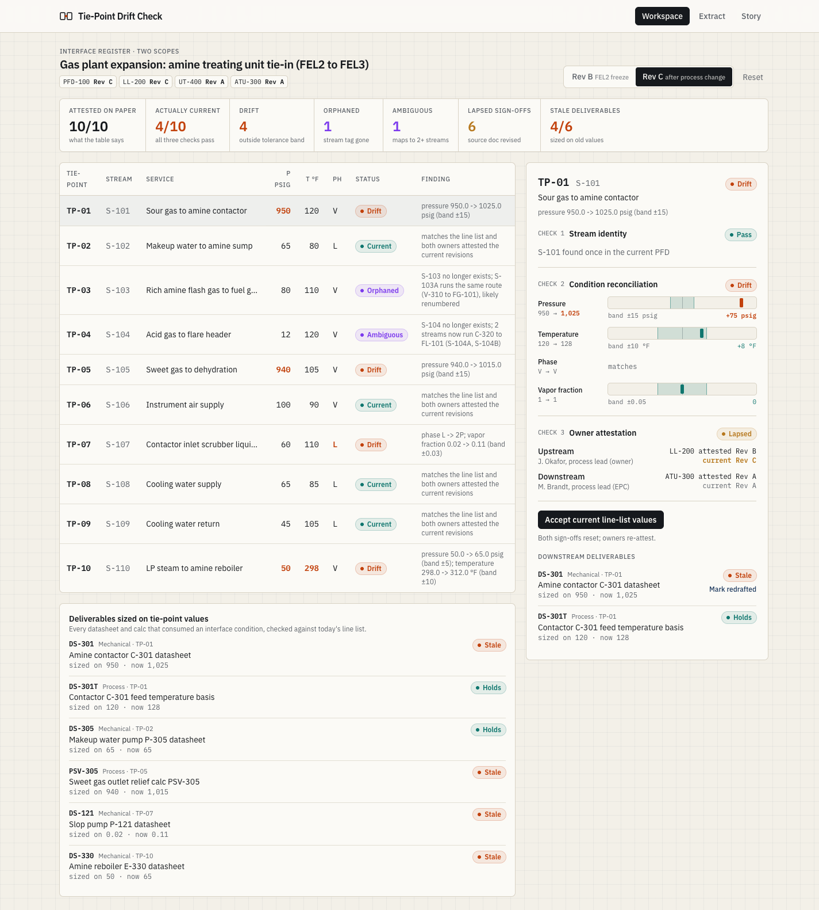
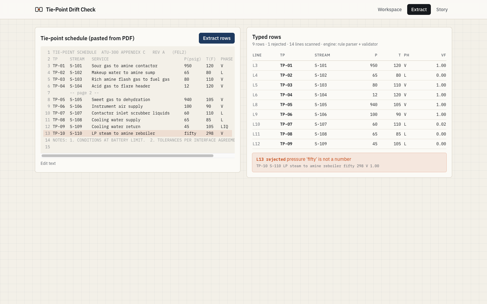
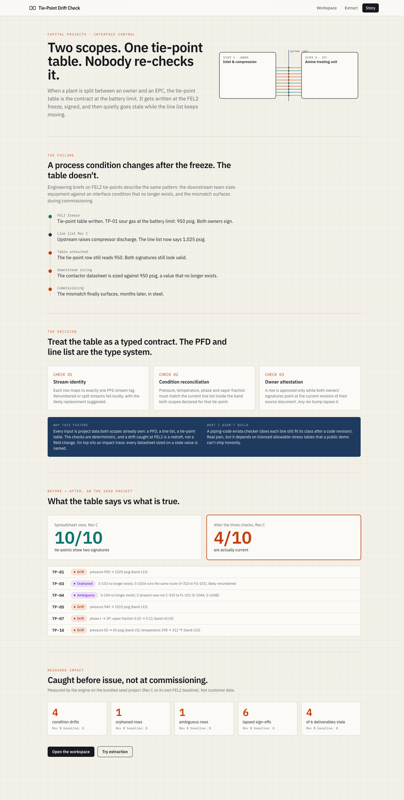

# Tie-Point Drift Check

Catch drift in the tie-point table between two engineering scopes **before issue, not at commissioning.**



## The problem

On capital projects split between an owner and an EPC (or two EPCs, or an EPC and a package vendor), the
**tie-point table** is the contract at the battery limit: for each interface stream it fixes pressure,
temperature, phase and composition, and both sides sign it at the FEL2 freeze.

Then the line list keeps moving and the table doesn't. Engineering briefs on FEL2 tie-points describe the
pattern: a process condition changes after the freeze, the mechanical group sizes a pump against the old
pressure, the downstream team sizes an exchanger against a stream that no longer exists, and the mismatch
surfaces during commissioning. Both signatures still look valid the whole time.

## What this does

It treats the tie-point table as a **typed contract**, with the PFD stream list and the line list as the type
system, and runs three deterministic checks on every row:

1. **Stream identity**: the row maps to exactly one stream tag in the current PFD. A deleted tag is
   *orphaned* (with a renumber suggestion when exactly one stream still runs the same route); a tag that now
   maps to two streams is *ambiguous*.
2. **Condition reconciliation**: P, T, phase and vapor fraction match the current line list inside the
   tolerance band declared for that tie-point (band edges inclusive).
3. **Owner attestation**: a row is approved only while both owners' signatures point at the *current*
   revision of their source document. A rev bump on either side lapses it automatically.

On top of the checks:

- **Impact trace**: every downstream datasheet or calc that was sized on a tie-point value is checked
  against today's line list and flagged when it was sized on a value that no longer holds.
- **Resolve loop**: accept the current values (or re-point to a renumbered/split stream), both sign-offs
  reset, owners re-attest at the current revision, deliverables get marked redrafted.
- **Extraction**: paste a tie-point schedule copied out of a PDF and get typed rows, each value carrying the
  source line it came from. Rows that fail validation are listed with the reason, never dropped. An LLM
  extractor is used when `ANTHROPIC_API_KEY` is set; otherwise a deterministic parser. Both go through the same
  Pydantic validator, and an LLM row whose id isn't on its cited line is rejected.
- **/story**: an animated explainer of the problem, the decision and the measured result.

| Extract | Story |
| --- | --- |
|  |  |

## Measured on the bundled seed project

The seed is a fictional gas plant expansion: an amine treating unit (EPC scope) tied into inlet and compression
facilities (owner scope) through 10 tie-points, with 6 downstream deliverables. Rev B is the FEL2 freeze;
Rev C is the same project after an upstream process change, with the tie-point table untouched.
These numbers are computed by the engine on that seed data (see `engine/tests/test_checker_store.py`), not
customer data:

| | Rev B (FEL2 freeze) | Rev C (after change) |
| --- | --- | --- |
| Rows with two signatures | 10 / 10 | 10 / 10 |
| Rows actually current (all three checks pass) | 10 / 10 | **4 / 10** |
| Condition drifts outside band | 0 | 4 |
| Orphaned / ambiguous stream tags | 0 / 0 | 1 / 1 |
| Lapsed sign-offs | 0 | 6 |
| Deliverables sized on stale values | 0 / 6 | **4 / 6** |

Working the resolve loop on Rev C (accept, re-attest, redraft) takes it back to 10 / 10 current and 0 stale
deliverables (`test_full_resolution_reaches_all_current`).

## How it works

```
engine/tiepoint/
  models.py      Pydantic types: Stream, LineEntry, TiePoint (+ tolerance, attestations), Deliverable, Project
  identity.py    check 1: exact tag, same-route renumber suggestion, ambiguous on split/duplicate
  reconcile.py   check 2: per-attribute delta vs declared band
  attest.py      check 3: attestation pinned to doc revision; lapsed / pending / current
  impact.py      deliverables sized on values the current line list no longer holds
  checker.py     runs everything -> report + summary
  extract.py     Extractor protocol: RuleExtractor, LLMExtractor, shared validator with source lines
  store.py       Repository protocol + in-memory implementation (accept / attest / redraft / reset)
  api.py         FastAPI routes, serves the built web app
web/src/          React + TypeScript workspace, Extract page, /story
```

Status precedence per row: identity failure > condition drift > lapsed/pending attestation > current.

## Run it

Requirements: Python 3.11+, Node 20+.

```sh
# engine
cd engine
python -m venv .venv && .venv/bin/pip install -e ".[dev]"     # add ".[dev,llm]" for the LLM extractor
.venv/bin/python -m pytest -q
.venv/bin/uvicorn tiepoint.api:app --port 8742

# web (second terminal)
cd web
npm install
npm test
npm run dev        # http://localhost:5742, proxies /api to :8742
# or: npm run build, then the engine serves web/dist at http://localhost:8742
```

## Stack

Python (FastAPI, Pydantic v2, pytest) for the check engine and API; TypeScript, React, Vite, Tailwind,
Framer Motion and Vitest for the workspace. Optional Claude-backed extraction via the Anthropic SDK.

## Tests

- `engine/tests`: 47 pytest tests (each check's pass/fail/edge cases, checker summaries on both revisions,
  the resolve loop, extraction and validation of LLM output, API round trips).
- `web/tests`: 12 Vitest tests (band geometry, formatting, summary strip, table, detail panel actions).

## Notes

The seed project, document numbers and people are fictional. Tolerance bands are illustrative, not design
guidance. This is a standalone demo; the repository interface has a slot for a Postgres implementation.

Built with Claude Code.
